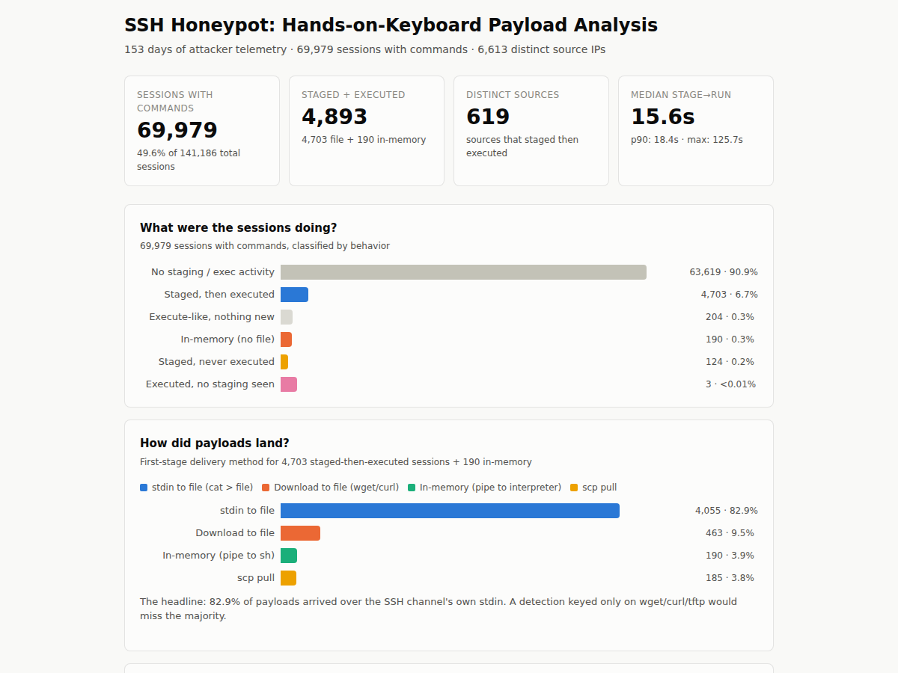

**Jenna Frank (Hot Pink Huntress)**, Security Operations Manager · [Portfolio](https://www.JennaFrank.co) · [Repository](https://github.com/jennafrank/the-honeypots)

I built a custom Python SSH honeypot that poses as a Solana validator node, and left it on an Azure VM with port 22 open for 147 days (April 27 to September 21, 2026). It accepted every password, logged every command, and tagged each session with MITRE ATT&CK techniques. The [full threat intelligence report](report.html) covers 136,128 sessions from 6,145 source IPs: who connected, what they ran, and what defenders should do about it.

## The problem

SSH password brute force is constant background noise on any internet-facing server. I wanted to see what attackers do *after* a login succeeds, which failed-login alerting never shows.

## What I did

- **Built the sensor:** an asyncssh server with a fake Bash shell, a fake filesystem and process list, and 17 traps that record when a lure is touched.
- **Collected the data:** every session, credential and command went to SQLite. It was GeoIP-enriched and mapped to ATT&CK as it arrived.
- **Analysed it:** sessions were grouped by depth, campaigns by command shape, and possible hands-on-keyboard operators were flagged by timing and typos.
- **Audited my own numbers:** I found that the sensor double-logs chained commands, reproduced the report's population from the database, and [published a correction](command-count-correction.md).

## Key findings

| | |
|---|---|
| Sessions | 136,128 (926 per day) |
| Unique source IPs | 6,145 |
| Commands | 370,429 ([corrected](command-count-correction.md)) |
| Sessions that ran zero or one command | 96.3% |
| Sessions from an IP seen before | 95.5% |

- **Success is the signal, not failure.** One IP logged in successfully 8,949 times in about 8 hours and ran only an "ok" ping. Tools that count failed logins never see it.
- **Mining, not wallet theft.** 3,692 sessions deployed a miner, and only 5 read the fake wallet. The main campaign was an 81-command script in 3,210 sessions. It staged in `/dev/shm`, persisted through cron and a systemd unit, and dropped a binary named `astats`.
- **Bots fingerprint honeypots.** 382 sessions ran checks for Cowrie's default paths and for containers.
- **Recommendation:** disable SSH password authentication. Every session in the dataset started with an accepted password.

*Payload delivery over the longer 153-day window (to September 26, 2026), so the counts differ from the 147-day report.*

## Read more

- [SSH Honeypot Threat Intelligence Report, 147 days](report.html) (corrected edition)
- [Command-count correction note](command-count-correction.md)
- [Brute-force analysis](https://github.com/jennafrank/the-honeypots/blob/main/reports/brute-force-lm-analysis.md) and [architecture](https://github.com/jennafrank/the-honeypots/blob/main/ARCHITECTURE.md) on GitHub
- [Source code and setup](https://github.com/jennafrank/the-honeypots)

[Back to my portfolio](https://www.JennaFrank.co)
